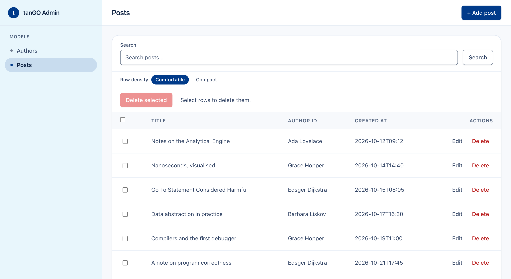

<picture>
  <source media="(prefers-color-scheme: dark)" srcset="docs/images/tango-logo-light.png">
  
</picture>

[](https://pkg.go.dev/github.com/angvp/tango)
[](https://github.com/angvp/tango/actions/workflows/ci.yml)
[](https://codecov.io/gh/angvp/tango)

**tanGO is a small, explicit web framework for Go, inspired by Django's ergonomics but built from plain Go structs and interfaces.** Write models as structs, get typed migrations, a server-rendered admin and a JSON API from the same code. Scaffolding writes plain Go you own: nothing is generated at runtime, boot never scans your filesystem, and there is no hidden configuration.

**Status: pre-1.0, released as v0.x.** The Covered API in [Versioning and compatibility](docs/compatibility.md) is what a release promises not to break; a minor release may still break it, only after the deprecation window, and says so in the [changelog](CHANGELOG.md). Anything marked "planned" or "future" in the docs is not built yet. Read [Limitations](docs/limitations.md) before depending on tanGO for anything beyond what it says it does.

## Quick start

```sh
go install github.com/angvp/tango/cmd/tango@latest
tango newproject shop
cd shop
go run .
```

`tango newproject` scaffolds a `go.mod`, a `main.go` pre-wired for SQLite and the admin app, a `project` package where your apps are listed, and a `shell` program for `tango shell`, and it runs unchanged. Run `tango makemigrations`, `tango migrate` and `tango admin create <username>` to create your first admin account, then open `/admin/` (the project prints its address when it starts).

To add tanGO to an existing module instead, run `go get github.com/angvp/tango`. The `tango` CLI is optional but recommended: it wraps `go run`/`go build` with a few conventions the framework expects your `main.go` to implement.



*The server-rendered admin over two models, from [`examples/api-with-admin`](examples/api-with-admin).*

## A route in six lines

The fastest way to see a complete application is [`examples/jsonapi`](examples/jsonapi): a separate Go module whose one app answers a JSON route. Its `main.go` is written by hand, so it shows every line of a small application. Its app registers one named route:

```go
func (App) Register(registry *tango.Registry) error {
	return registry.Routes().Include("/greetings/", tango.URLs{
		tango.Path("GET", "/{name}/", hello, tango.Name("hello")),
	})
}

func hello(ctx *tango.Context) error {
	name := ctx.Param("name")
	return ctx.JSON(200, map[string]string{"message": "Hello, " + name + "!"})
}
```

Run it:

```sh
cd examples/jsonapi
go run .
curl http://localhost:8000/greetings/World/
# {"message":"Hello, World!"}
```

`tango newapp greetings` scaffolds an app stub like this one and prints the line that installs it: adding it to `InstalledApps` in `project/project.go` is one line you write yourself, because tanGO never edits your code for you. `tango shell` opens a Go prompt on your models and database for looking at, or fixing, a few rows.

## What you get

- **Explicit lifecycle**: `Config`, `App` and `Registry`; nothing boots implicitly.
- **Routing**: named routes with reverse lookup, built on [chi](https://github.com/go-chi/chi) internally (chi is never part of your imports), and `Context` helpers for JSON, request binding and redirects.
- **Models from structs**: a handful of tags (`tango:"pk"`, `tango:"unique"`, `tango:"index"`, `tango:"fk=Other"`) and no schema DSL.
- **Persistence**: `db.Store` for CRUD, queries and raw SQL on SQLite, PostgreSQL or MySQL, with foreign keys, two-layer validation and cascade delete. See [relationships and admin foreign keys](docs/guides/relationships-and-admin-foreign-keys.md).
- **Typed Go migrations**: `tango makemigrations`, `migrate` and `migrate down`.
- **Admin**: server-rendered list, create, edit and delete with pagination, search, filters and ordering, behind a session-cookie login with CSRF protection and a rate-limited login. Accounts are managed with `tango admin create/resetpassword/deactivate`.
- **Batteries, each optional**: accounts with password reset, email verification and a JSON mode for single-page apps; SMTP `mail`; `storage` with local-disk and S3 stores; `cache` with in-process, Redis and Memcached stores; WebSocket rooms; a token-bucket rate limiter.
- **OpenAPI 3.1** generated from your routes, with Swagger UI (`openapi.New`, or `openapi.Dev` to serve it only while developing).
- **A CLI** (`tango run/check/makemigrations/migrate/newproject/newapp/tui/shell/admin`) that wraps ordinary `go build` and `go run` rather than replacing them.

## Principles

> If writing normal Go is simpler than invoking tanGO, write normal Go.

- Prefer Go primitives before replacing them.
- Prefer explicit structure over convention magic.
- Treat JSON and API-only apps as first-class. HTML is optional.
- The admin is a normal app, not a privileged subsystem.
- No custom template language.
- Third-party internals stay behind tanGO's abstractions.

## Where to continue

- **[Tutorial](docs/tutorial/01-bootstrap-routing-json.md)** — build one application, a bulletin board, from an empty directory to a deployed container in ten parts: routing and JSON views, persistence and migrations, the HTML admin, foreign keys, server-rendered pages, accounts and forms, API tokens and rate limits, a live WebSocket feed, background jobs and graceful shutdown, and testing and deployment.
- **[Guides](docs/guides/)** — standalone, task-oriented references: project structure, application architecture, configuration, models and tags, routing, `Context`, persistence, migrations, admin, app checks, security headers and Content-Security-Policy, OpenAPI documentation, background jobs, accounts, mail, uploads, caching, rate limiting, realtime, dialect setup, reusable apps, and relationships/admin foreign keys.
- **[API reference](docs/reference.md)** — the supported public surface, linked to runnable examples. Generated package docs are also available via `go doc` or [pkg.go.dev](https://pkg.go.dev/github.com/angvp/tango).
- **[Examples](examples/)**, each with a README giving its purpose and commands:
  - [`jsonapi`](examples/jsonapi): the smallest JSON application, one hand-written app;
  - [`api-with-admin`](examples/api-with-admin): a JSON API and the HTML admin over one set of models, linked by a foreign key;
  - [`notes-starter`](examples/notes-starter): a keepable starter with generated migrations, the admin and rate limiting;
  - [`jwt-api`](examples/jwt-api): a JSON route behind stateless bearer JWTs;
  - [`realtime-chat`](examples/realtime-chat): WebSocket rooms with JWT auth and graceful shutdown;
  - [`accounts-mail`](examples/accounts-mail): the `accounts` app's password reset and email verification, with emails printed to the terminal;
  - [`spa-accounts`](examples/spa-accounts): the backend of a single-page app: `accounts`' JSON mode with bearer tokens, a host profile written in the registration transaction, a JSON field edited in the admin, and bounded `varchar` fields;
  - [`uploads`](examples/uploads): a document locker: `storage.Upload` reads one multipart file, the host keeps the generated key in its own model, and `storage.Serve` delivers it to its owner, on the local disk;
  - [`cache`](examples/cache): `cache.FetchJSON` over a bounded in-process cache for a recomputable read, with a versioned prefix and a fail-open hook;
  - [`reusable-greetings`](examples/reusable-greetings) and [`reusable-greetings-host`](examples/reusable-greetings-host): a reusable app with contributed migrations and static assets, and a host installing it;
  - [`board`](examples/board): the tutorial's finished application, deployable as a container.
- **[Versioning and compatibility](docs/compatibility.md)** — what each release promises not to break, deprecations, and the [changelog](CHANGELOG.md).
- **[Limitations](docs/limitations.md)** — non-goals, security boundaries, and dialect differences.

## Contributing

Bug reports and focused pull requests are welcome; [CONTRIBUTING.md](CONTRIBUTING.md) covers setup and what a change needs, and [SECURITY.md](SECURITY.md) covers reporting a vulnerability.

## Verifying the docs

Documentation in this repository is checked, not just written: every checked-in example under `examples/` is built as its own module in CI, so a stale command or import path in a doc snippet gets caught rather than silently drifting from what actually runs. Run the same check locally before sending a documentation change:

```sh
go test ./...
```

`scripts/check.sh` runs everything CI runs (the Redis and Memcached adapter tests need a server and skip without `TANGO_TEST_REDIS_URL` and `TANGO_TEST_MEMCACHE_ADDR`): gofmt, vet, build, the tests and the offline link check (with `lychee`, or its pinned Docker image when `lychee` is not installed).

`TestExamplesAreIndependentModulesThatCompile` (at the repository root) builds every `examples/*` module and runs its generated `-check` flag; the migration-generation tests in `internal/cli` similarly `go build` a real generated `migrations` package rather than only inspecting its source text.

## License

MIT — see [LICENSE](LICENSE).
